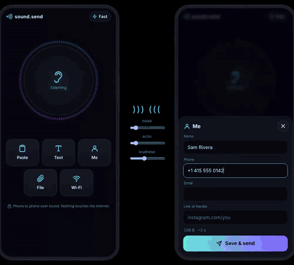
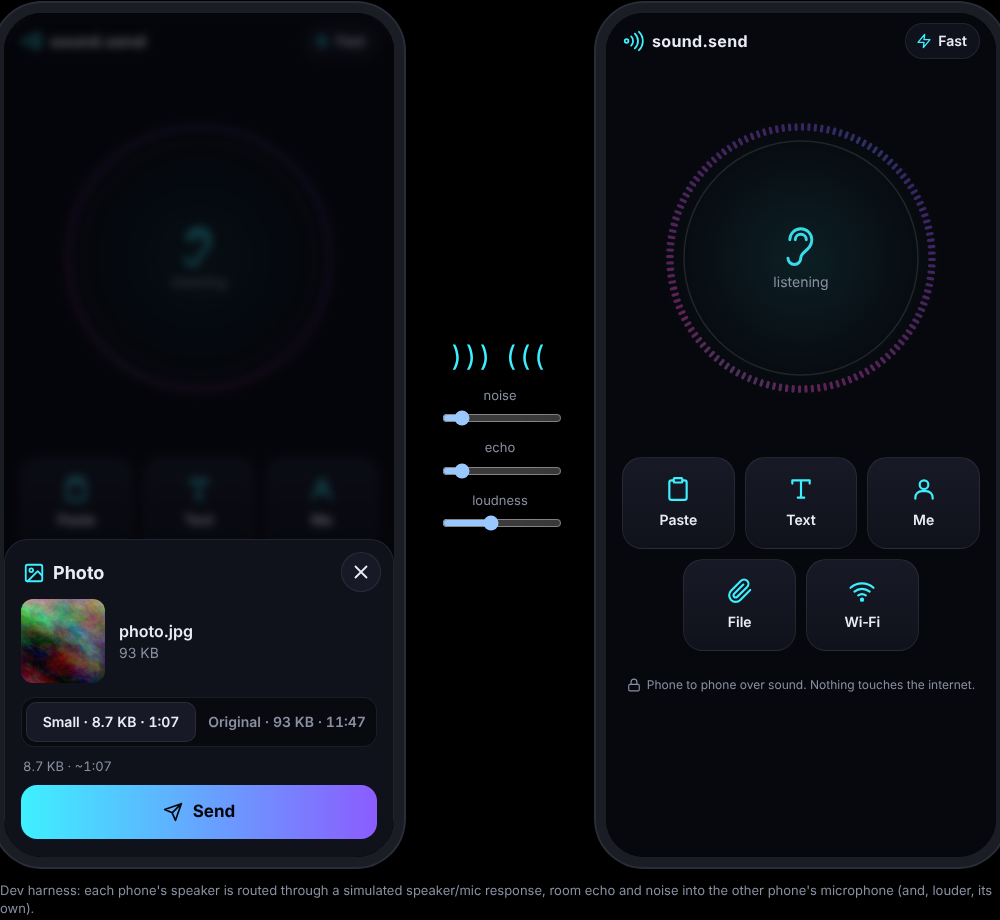
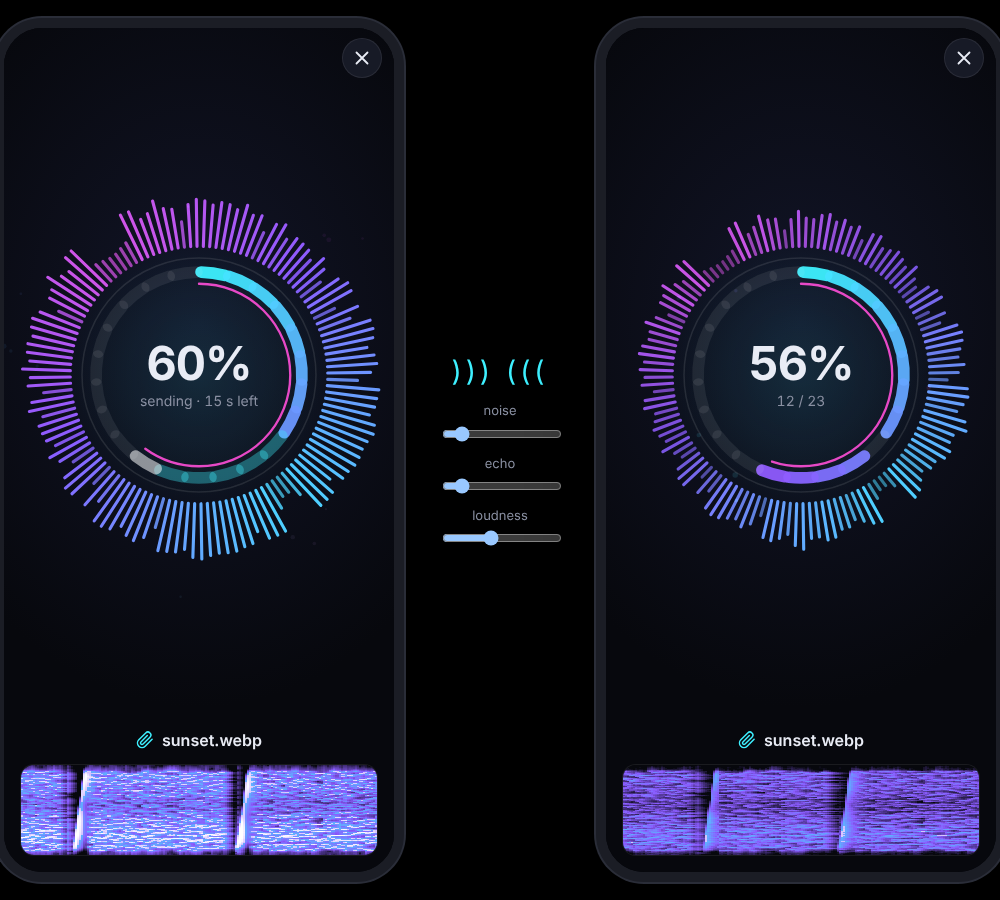
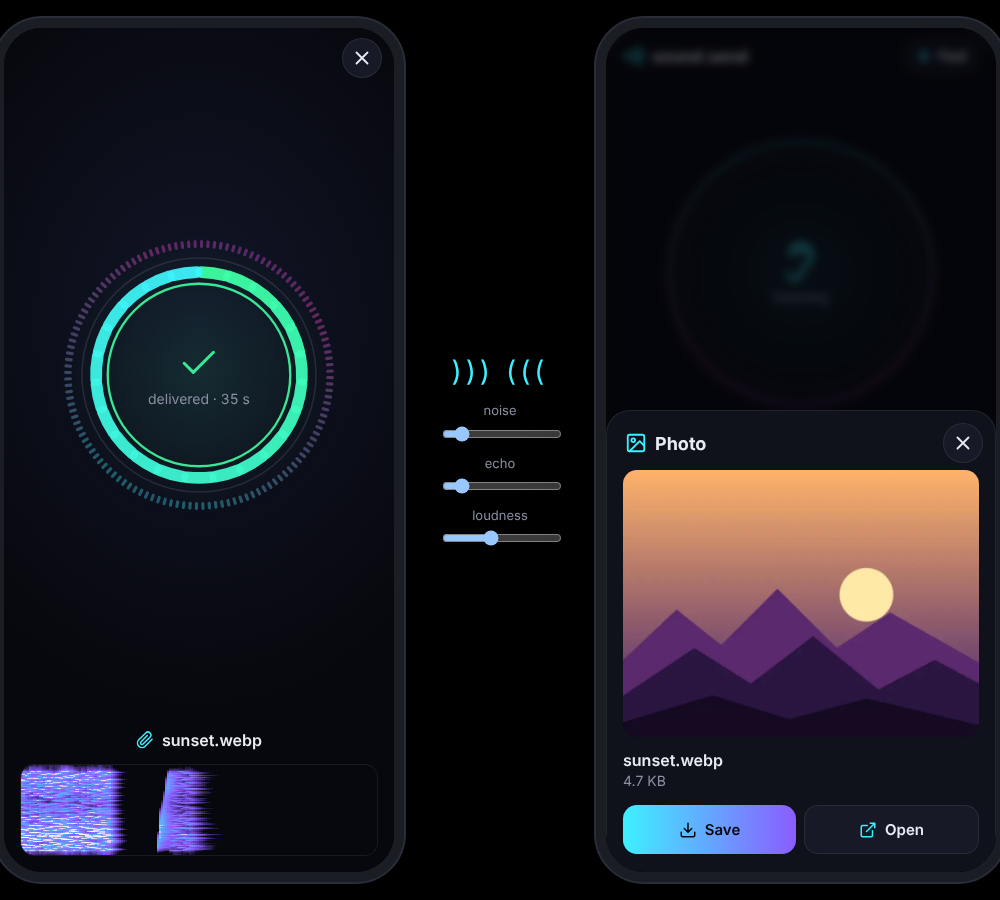
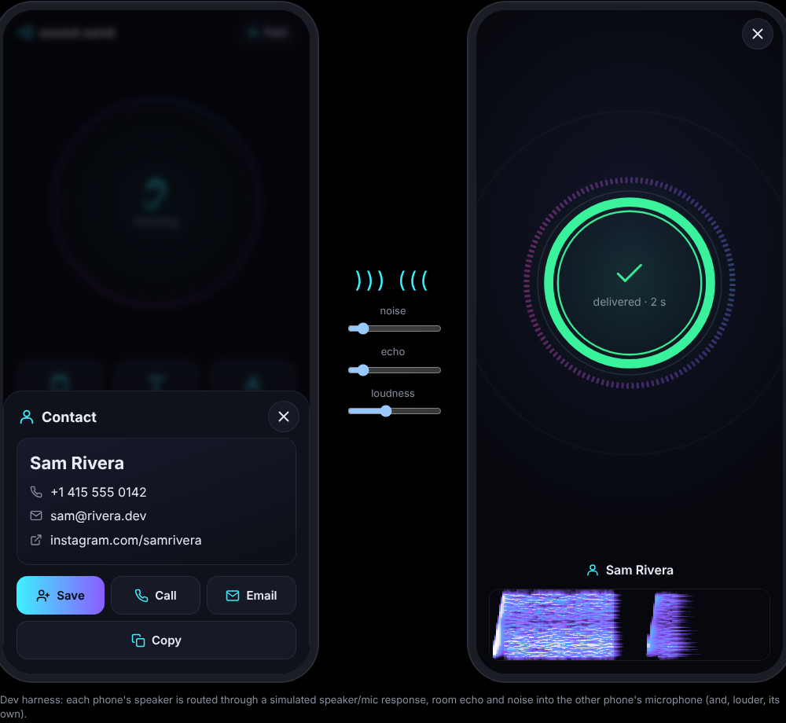
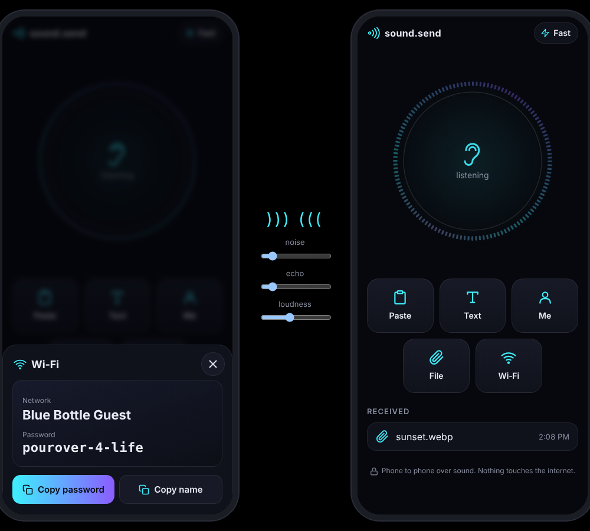

# sound.send

Send text, links, your contact card, Wi‑Fi details, photos and files to the
phone next to you, over sound. Both people open the same URL. No accounts, no
pairing, no internet once the page has loaded.



| Pick | Send | Got it |
|---|---|---|
|  |  |  |
|  |  | |

## What it can send

- **Paste**: whatever is on the clipboard (text or an image).
- **Text**: anything typed; links get an Open button, a phone number gets Call.
- **Me**: your contact card (saved on the device), as a vCard the other phone
  can add to its contacts.
- **Contact** (Android Chrome): any contact via the Contact Picker.
- **File**: any file or photo. Photos are shrunk to ~10 KB by default (about a
  minute); the original is one tap away, with its time estimate.
- **Wi‑Fi**: network name and password, with Copy password on the other side.
- **Share to** (installed on Android): share text, links or files from other
  apps straight into sound.send.

The receiver gets Copy, Open, Call, Email, Save and Share buttons as they
apply, and a list of what it received. The sender gets a tick only once the
receiver has checked the whole transfer's checksum.

## Speed

| | Fast (default) | Slow |
|---|---|---|
| Use | phones side by side | noisy or echoey rooms, more distance |
| Band | 1.2–7.6 kHz | 1.2–4.4 kHz |
| Net rate | ~130 B/s | ~30 B/s |
| A text message | ~2 s | ~4 s |

If a fast transfer gets no reply, or replies show nothing arriving, the
sender switches to slow on its own. A receiver always hears both.

## How it works

**Modem** (`js/modem.js`). Each frame is a linear chirp (up for fast, down for
slow), a header symbol and data symbols. A data symbol plays one tone in each
of 16 groups of 8 tones (fast; slow uses 8 groups of 16), so it carries 48 bits.
Tones sit on exact multiples of 1/T over a 20 ms window (40 ms slow), and each
symbol has a guard interval, so any window that starts after the previous
symbol's echo sees the tones as orthogonal. The receiver finds chirps with an
FFT matched filter, fine-tunes timing on the header, measures tone energies
with Goertzel filters, subtracts each tone's background (hums, whistles) and an
estimate of the previous symbols' echo, then decodes.

**Error handling**. Every frame is whitened, protected by Reed-Solomon (20–33% parity
fast, 32–40% slow) and a CRC-16. If plain error correction fails,
the least confident bytes are retried as erasures. Every transfer carries a
CRC-32.

**Protocol** (`js/link.js`). Selective-repeat ARQ: the sender plays a burst of
frames and asks for an ACK; the ACK says what arrived; missing chunks go out
again. Lost ACKs are recovered with a short POLL. If the other phone can never
be heard, the sender cycles through the chunks a few times so a listen-only
phone still gets everything. Carrier sense and random backoff sort out both
phones talking at once.

## Running it

It's static files with no build step. The microphone needs HTTPS (or
`localhost`):

```bash
npx http-server -c-1 -p 8080 .   # then open http://localhost:8080
```

For phones, put the folder on any HTTPS static host. For
`send.brannon.online`, point the subdomain at the host and serve this
folder as the site root.

## Tests

```bash
npm test
```

- `test/rs.test.mjs`: Reed-Solomon errors and erasures, CRCs.
- `test/modem.test.mjs`: frames through a simulated phone-to-phone channel
  (small-speaker response, 44.1/48 kHz mismatch and clock drift, room echo,
  noise, hum and a whistle).
- `test/link.test.mjs`: the protocol over lossy simulated air (30% loss,
  one-way, fallback to slow, cancel, both phones sending at once).
- `test/message.test.mjs`: payload format, vCard and Wi‑Fi parsing.

`dev/two-phones.html` runs two copies of the app side by side, wired
together through simulated air with noise, echo and loudness sliders. The
README demo and screenshots were recorded from it.

## Notes

- Turn the volume up and keep the phones within a hand's width; the bottom
  edges (speaker and mic) close together works best.
- iPhones hide the Contact button (no Contact Picker in Safari) and ignore
  the share target.
- Keep the screen on during long transfers; the page asks for a wake lock.
